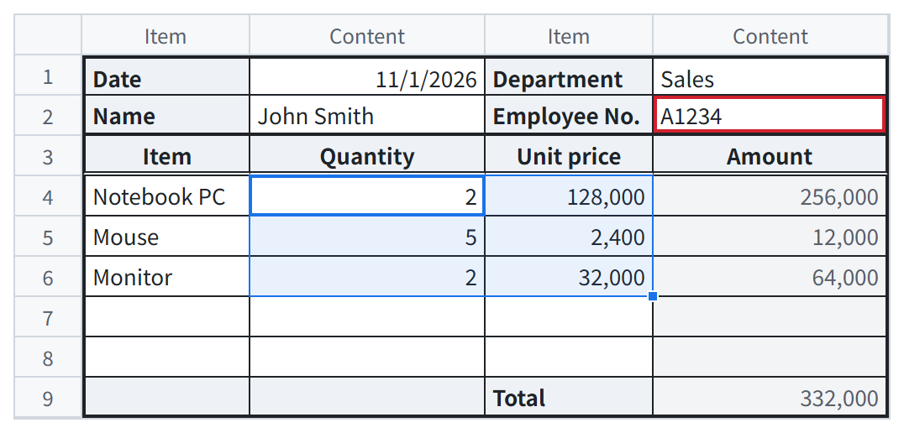
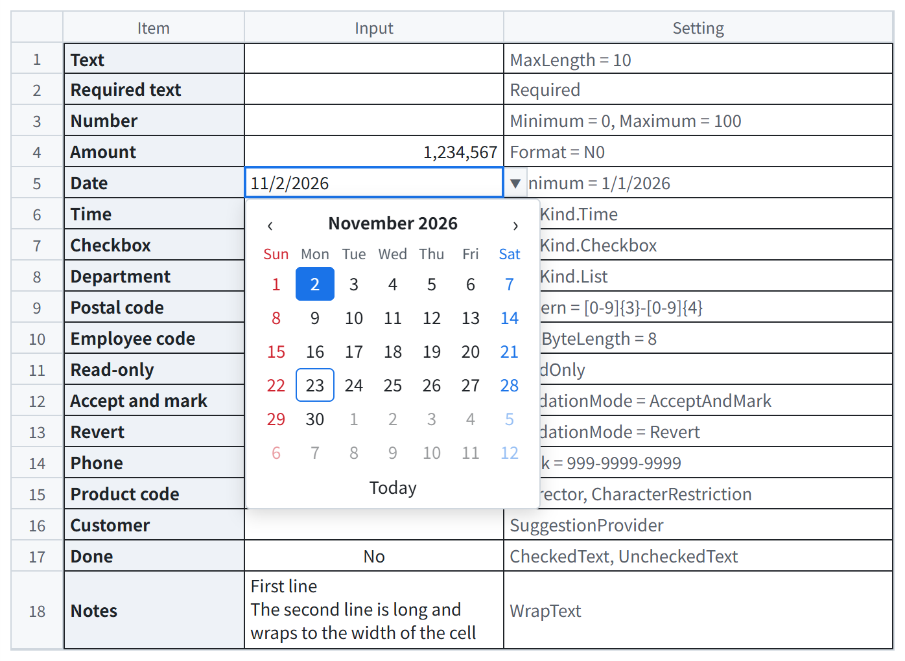
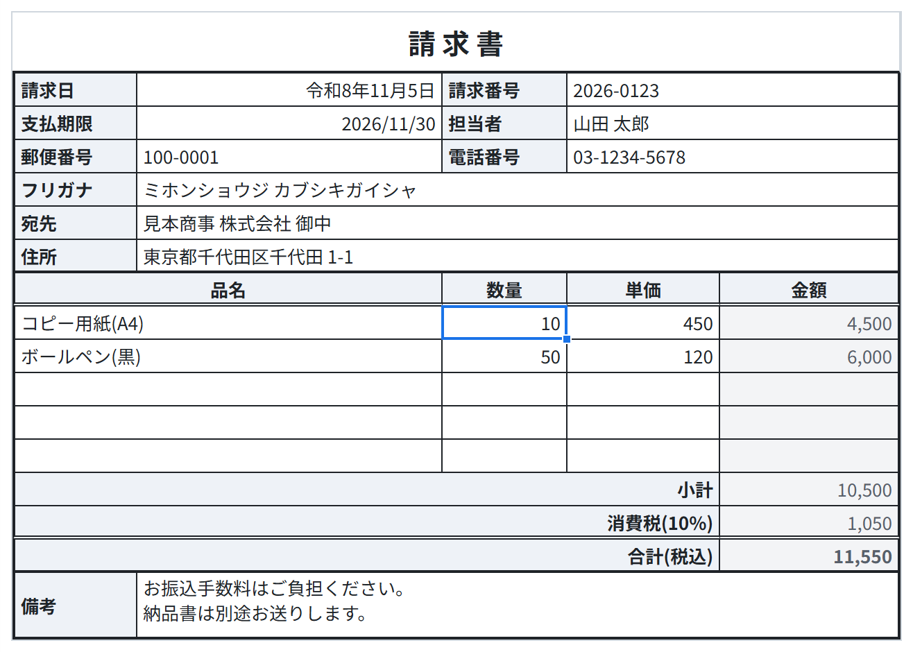

# MusselSheet - Input sheet for Blazor

[](https://www.nuget.org/packages/MusselSheet/)
[](https://www.nuget.org/packages/MusselSheet.Core/)
[](https://usausa.github.io/mussel-sheet/)

## 🐚 What is this?

An Excel-like input sheet for Blazor, made for keyboard and IME entry.  
Each cell has its own kind, rules and style, so one sheet works as a list or a form.  
The sheet itself is in `MusselSheet.Core`, without UI, so a server can build and read sheets too.  

| 📝 Form | 📅 Cell kinds | 🧾 Japanese form |
|:-:|:-:|:-:|
|  |  |  |

## 🚀 Quick Start

Link the stylesheet in the page head.  

```html
<link rel="stylesheet" href="_content/MusselSheet/MusselSheet.css" />
```

Create a `Sheet` and show it in an interactive component.  

```razor
@page "/"
@using MusselSheet

<MusselSheetView Sheet="sheet" CellCommitted="OnCommitted" />

@code {
    private readonly Sheet sheet = CreateSheet();

    private static Sheet CreateSheet()
    {
        var sheet = new Sheet(5, 2);
        sheet.Columns[0].Header = "Item";
        sheet.Columns[1].Header = "Quantity";
        sheet.Range("B:B").Configure(static c =>
        {
            c.Kind = CellKind.Number;
            c.Minimum = 0;
        });
        sheet.SetValues(0, 0, [["Notebook", 10m]]);
        return sheet;
    }

    private void OnCommitted(CellCommittedEventArgs e) => Console.WriteLine($"{e.Address}: {e.Value}");
}
```

The `Example` project shows the main features on Server and WebAssembly, a page for each.  

## 🎨 Look

| Part | Detail |
|---|---|
| Theme | CSS variables shared with the Mussel family (`--mussel-primary-text`, `--mussel-grid-line` and more), `--mussel-sheet-*` for the sheet, and the dark `mussel-dark` |
| Cell style | Alignment, bold, italic, underline, strikethrough, font size, indent, font and fill colors, `CssClass` |
| Borders | Thin, medium, thick, dashed, dotted and double lines in any color |
| Marks | Errors, changed cells, read-only cells and input messages |

## ✅ Supported features

| Category | Detail |
|---|---|
| **Cells** | Text, number, date, time, checkbox, list, mask, auto complete, label and custom editors |
| **Input rules** | Required, minimum and maximum, length in characters and bytes, pattern, allowed characters and C# validators |
| **Entry** | Typing starts at once, from the first character of an IME; configurable Enter and Tab, move groups and adding a row on the last Enter |
| **Ranges** | Selection, copy and paste with Excel, fill handle with series, Ctrl+Enter, Ctrl+D and Ctrl+R |
| **Structure** | Merged cells, frozen rows and columns, inserting and deleting rows and columns, undo and redo |
| **Data** | Binding to objects, computed cells, C# callbacks for correcting, formatting and styling, and saving the design as JSON |
| **Scale** | With a fixed `Width` and `Height`, only visible rows and columns are drawn; tested with 10,000 rows x 50 columns |
| **Languages** | English and Japanese built in, others as data of the same shape; eras, date forms and character sets |
| **Hosting** | Interactive Server, WebAssembly (also trimmed) and Auto; the core also runs without UI and with Native AOT |

## 📖 API

See the [API reference](Document/API.md) and the [specification](Document/SPEC.md).  

## 🌊 Mussel family

- [MusselChart](https://github.com/usausa/mussel-chart) - Charts
- [MusselSheet](https://github.com/usausa/mussel-sheet) - Input sheet
- [MusselCalendar](https://github.com/usausa/mussel-calendar) - Calendar
- [MusselDiagram](https://github.com/usausa/mussel-diagram) - Diagram editor
